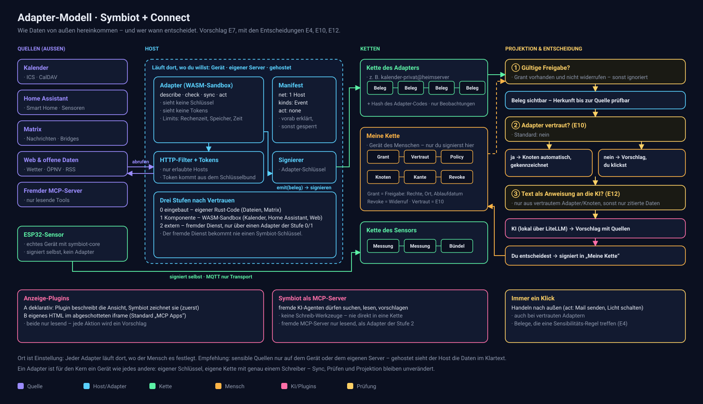

# Entscheidungen

Stand: 2026-11-10. Jede Entscheidung hat einen Status: **entschieden** (vom Besitzer), **Vorschlag** (wartet auf
den Besitzer) oder **offen**. Was hier entschieden ist, gilt vor PLAN.md und FEATURES.md, bis diese nachgezogen sind.

## E1 — Symbiot und Connect sind ein System · *entschieden*

Ein Projekt, ein System. Connect (Austausch mit Menschen, Maschinen, Daten, dem eigenen Gedächtnis) ist
kein eigenes Produkt, sondern der Teil von Symbiot, der über einen einzelnen Menschen hinausgeht – bisher
„Phase WIR / ALLE“.

**Der Mensch entscheidet, wo welche Schicht liegt:** auf dem Gerät, auf dem eigenen Server oder gehostet.
Wir geben nur Empfehlungen. Daraus folgt für die Architektur:

- Jede Schicht (Kette und Speicher, KI, Sync-Knoten, Adapter, Oberfläche) muss auf jedem dieser Orte laufen
  können. Kein Teil darf voraussetzen, dass ein anderer am selben Ort läuft.
- Die Empfehlung ist Teil der Einrichtung und ist veränderbar, z. B. „Kette auf dem Gerät, Kopie auf dem
  eigenen Server, KI lokal; Claude nur über den Masken-Filter“.

## E2 — Löschen: Löschmarker + Inhalts-Hash · *entschieden, umgesetzt (Protokoll 2)*

Löschen heißt: ein neuer, signierter Eintrag `DeleteNode` bzw. `Unlink` (Löschmarker). Die Kette bleibt
lückenlos prüfbar, die Projektion zeigt den Knoten bzw. die Kante nicht mehr.

**Ergänzung (entschieden):** Ein Löschmarker allein entfernt den Inhalt nicht – Titel und Text stehen weiter
im früheren Eintrag. Damit „löschbar“ wirklich löscht, schlagen wir vor, das Kettenformat **vor M4** so zu
ändern, dass die Signatur nicht über den Inhalt selbst läuft, sondern über dessen Hash:

```
hash = sha256(prev ‖ postcard(kopf) ‖ sha256(inhalt))
```

Dann darf ein Gerät nach einem Löschmarker den Inhalt früherer Einträge wegräumen (nur der Inhalts-Hash
bleibt), und `verify()` bestätigt die Kette trotzdem. Geräte, die eine Kopie haben, räumen beim Sync ebenso
auf. Ein fremdes Gerät kann dazu nicht gezwungen werden – das gilt für jede Löschung in einem verteilten
System und muss in der Oberfläche ehrlich so stehen.

**Vollständig seit H1 (2026-11-10):** Weggeräumt wird der Inhalt jedes Eintrags, der über den Knoten spricht: seine
Fassungen, Vorschläge des Assistenten (`DecideSuggestion`), abgelehnte Vorschläge (`RejectProposal`). Der Kern
bestimmt das für jede Eintragsart mit einer Regel (`LedgerEntry::about`). Ein gelöschter Knoten bleibt als
Grabstein bekannt: Schreibt ein anderes Gerät später noch etwas über ihn, verliert auch dieser Eintrag seinen
Inhalt, auf jedem Gerät. `DecideSuggestion` nennt dafür im Kopf die Einträge, die es ausgeführt hat.

Löschen gewinnt für den gelöschten Knoten selbst, nicht für das, was daraus entstand: Nimmt jemand an einem Gerät
einen Schritt an, während ein anderes Gerät dessen Ziel löscht, bleibt der Schritt bestehen, ohne die Verbindung.
Vorher verschwand er, ohne je gelöscht worden zu sein, und sein Text blieb unlöschbar in der Kette.

## E3 — „Löschbar“ und „exportierbar“ entscheidet der Mensch, pro Knoten · *entschieden, umgesetzt*

- Bei jedem neuen Knoten lässt sich festlegen, ob er **löschbar** und ob er **exportierbar** ist.
  Standard: **beides ja**.
- Das ist eine **technische Unterscheidung ohne Einfluss auf das Datenmodell**: Knoten haben überall
  dieselbe Form, damit Knoten und Ketten zwischen Geräten und Installationen kompatibel bleiben.

**Umsetzung (entschieden 2026-10-31):** Die beiden Schalter stehen nicht im Knoten, sondern als **Richtlinie** in einem
eigenen Eintrag (`SetPolicy { node, deletable, exportable }`), den die Projektion auswertet:

| Richtlinie | Wirkung |
|---|---|
| löschbar | Löschmarker + Inhalt wird weggeräumt (E2) |
| nicht löschbar | Löschmarker blendet nur aus, Inhalt bleibt in der Kette (z. B. für Belege, die bewiesen bleiben müssen) |
| exportierbar | gleicht mit den eigenen Geräten ab, darf ins Backup, zu einer gehosteten KI und später zu Geräten anderer Menschen |
| nicht exportierbar | bleibt auf dem einen Gerät, auf dem er entstand: kein Abgleich, kein Backup, keine gehostete KI (siehe E5) |

**Entschieden:** Eine Richtlinie darf später verschärft und auch gelockert werden (nicht löschbar → löschbar).
Jede Änderung ist ein neuer signierter `SetPolicy`-Eintrag, im Verlauf sichtbar. „Nicht löschbar“ bedeutet
damit: nicht löschbar, solange der Mensch es nicht ändert.

**Drei Reichweiten, damit die Begriffe eindeutig sind (2026-11-10):**

| Reichweite | Gilt für | Wirkung |
|---|---|---|
| nur dieses Gerät | Knoten mit „nicht exportierbar“ | Der Inhalt verlässt das Gerät nie. Andere Geräte sehen nur den Kopf des Eintrags. |
| eigene Geräte | sensible Knoten (E4), alle Rohdaten (E14) | Abgleich zwischen den eigenen Geräten ja, externe KI und andere Menschen nein. |
| darf hinaus | alles andere | Darf an eine gehostete KI hinter dem Masken-Filter gehen. |

**Seit H2 (2026-11-10)** gilt „nur dieses Gerät“ für jeden Eintrag, der über den Knoten spricht, auch für
Vorschläge des Assistenten, und auch dann noch, wenn ein nicht löschbarer Knoten ausgeblendet wurde.

## E4 — Was ist sensibel? · *entschieden, umgesetzt*

**Umgesetzt (2026-11-07):** Eine Regel ist ein Name und Stichwörter (klein, mindestens drei Buchstaben); ein Knoten
ist sensibel, wenn Titel oder Text ein Stichwort enthält. Regeln sind Einträge (`AddSensitivityRule`,
`RemoveSensitivityRule`, Kennungen 10 und 11) und werden nie weggeräumt. Vorschläge macht nur das lokale Modell,
weil es dafür alle Knoten sieht.

- **Die KI erkennt** möglicherweise sensible Inhalte und **schlägt eine Regel vor** (z. B. „Gesundheitsdaten
  sind sensibel“). **Zur Regel wird es erst, wenn der Mensch zustimmt.** Angenommene Regeln sind Einträge in
  der Kette und werden danach deterministisch angewandt – die KI entscheidet nicht selbst.
- **Markieren von Hand** ist immer möglich, mit einem Klick, an jedem Knoten. Eine Markierung von Hand gilt
  vor jeder Regel.
- Sensible Knoten verlassen das Heimnetz nie, auch nicht zur gehosteten KI.

## E5 — Schlüsselverlust und Wiederherstellung · *entschieden (2026-10-31), umgesetzt in M4*

**Umgesetzt (2026-11-01):** 24 Wörter nach BIP39 (englische Liste), der Personen-Schlüssel wird daraus abgeleitet
und nie gespeichert. Gerätebestätigung und Widerruf sind Einträge (Kennungen 19 und 20). Freigabe für den Abgleich
über den Personen-Schlüssel statt einer Liste auf dem Heimserver (entschieden 2026-11-01). Noch offen: verschlüsseltes Backup
(E6).

Ja, wir brauchen ein Konzept – aber ein kleines. Backups und Umzug auf ein neues Gerät sind der richtige
Ansatz. Wichtig: Der **Geräteschlüssel wird dabei nicht mit umgezogen.**

- **Personen-Schlüssel:** Der Mensch hat einen eigenen Schlüssel (angezeigt als Wiederherstellungs-Wörter,
  ausgedruckt oder im Passwort-Manager). Er unterschreibt die Geräteschlüssel: „Dieses Gerät gehört mir.“
- **Neues Gerät:** bekommt einen **neuen** Geräteschlüssel, wird vom Personen-Schlüssel bestätigt und lädt
  das Backup bzw. synchronisiert die Ketten.
- **Verlorenes oder gestohlenes Gerät:** wird mit dem Personen-Schlüssel **widerrufen**. Einträge, die es
  nach dem Widerruf signiert, werden abgelehnt. Würde man den alten Schlüssel weiterverwenden, könnte ein Dieb
  im Namen des Menschen schreiben.
- **Backup** = alle Ketten, verschlüsselt (E6). Daraus lässt sich alles andere (Knoten, Kanten, Suche)
  wieder aufbauen.

| Wiederherstellbar | Nicht wiederherstellbar (bewusst) |
|---|---|
| alle Ketten, damit alle Knoten, Kanten, Verläufe, Richtlinien und Regeln | der alte Geräteschlüssel |
| Gerätebestätigungen und Widerrufe | Inhalte, die nach E2 weggeräumt wurden |
| | Knoten, die „nicht exportierbar“ sind (**entschieden:** auch das eigene Backup zählt als Export) |

**Folge, die die Oberfläche klar sagen muss:** „Nicht exportierbar“ heißt, der Knoten lebt nur auf diesem
einen Gerät. Geht das Gerät verloren, ist er weg. Beim Setzen des Schalters erscheint dieser Hinweis.

**Abweichungen (2026-11-10, PLAN H5 und H6):**
- Die Wörter sind öfter unterwegs, als „nie gespeichert“ nahelegt: Die Web-Oberfläche schickt sie an den Heimserver,
  der damit signiert, und jeder Import-Adapter braucht sie einmal (`SYMBIOT_WORDS`).
- BETRIEB.md empfiehlt, `device.key` des Heimservers zu sichern. Wer ein älteres Backup zurückspielt und
  weiterschreibt, erzeugt eine zweite Geschichte derselben Kette; die Geräte lehnen sie dauerhaft ab. Der Weg
  „neuer Geräteschlüssel, bestätigen, alles wieder holen“ fehlt noch: Geräte senden heute nur ihre eigene Kette,
  ein neu aufgesetzter Heimserver bekäme die Ketten der Adapter und seine alte Kette nicht zurück.

## E6 — Verschlüsselung des Speichers · *entschieden (2026-10-31)*

Ja, SQLite ist heute der einzige Speicher: Die Kette ist dort die Wahrheit, Knoten und Kanten sind daraus
abgeleitet. **Empfehlung: SQLite behalten und verschlüsseln, keine neue Datenbank.**

- **SQLCipher** (in `rusqlite` als Feature `bundled-sqlcipher`): die ganze Datei mit AES-256 verschlüsselt,
  auf Windows, macOS, Linux, Android und iOS erprobt, kein Umbau der Abfragen nötig.
- Der Schlüssel liegt im Schlüsselbund des Betriebssystems (Windows Credential Manager, macOS/iOS Keychain,
  Android Keystore) oder wird aus einer Passphrase abgeleitet; auf dem Server als Docker-Secret.
- Backups und Sync sind zusätzlich Ende-zu-Ende verschlüsselt, damit ein gehosteter Ort (E1) nur Chiffretext
  sieht.
- Der ESP32 hat keine Datenbank; er signiert nur und schickt weiter.

Alternative, falls SQLCipher in Tauri mobil Probleme macht: Inhalte vor dem Speichern einzeln verschlüsseln
(z. B. XChaCha20-Poly1305). Mehr Arbeit, aber unabhängig von der Datenbank.

## E7 — Adapter und Plugins · *entschieden (2026-10-31)*

Wie kommen Kalender, Nachrichten, Geräte im Haus, Gesundheitsdaten und andere Apps herein, und wie sehen
Anzeige-Plugins aus? Wir wollen auf dem Stand der Technik sein. Recherche: [RECHERCHE-ADAPTER.md](RECHERCHE-ADAPTER.md).

Bild: [adapter-modell.svg](adapter-modell.svg).



Entschieden: **Ein Adapter ist ein Gerät** mit eigenem Schlüssel und eigener Kette.
Fremde Adapter laufen als WebAssembly-Komponenten (wasmtime) mit vorab erklärten Rechten; der Host signiert,
nicht der Adapter. Der Mensch erteilt und widerruft Zugriffe als Einträge in seiner Kette. Adapter beobachten
nur; was daraus eigene Knoten oder Handlungen werden, bleibt ein Vorschlag. Zuerst: Kalender, Home Assistant,
Matrix lesend, dazu ein MCP-Server von Symbiot (nur lesen und vorschlagen).

**Ergänzt durch E14:** Adapter gehören zur Integrationsschicht: Sie laden Rohdaten und deuten nichts. Aufbereiter
sind eine zweite Art von Gerät, die aus Rohdaten Dinge ableitet. Die ersten Adapter sind Importe (M7).

**Abweichung (2026-11-10, PLAN H6):** Der Import aus der App (#44) lädt Rohdaten in die Kette des Geräts, an dem
man sitzt, also eines Menschen-Geräts. Das widerspricht „ein Adapter ist ein Gerät“ und E13 („gebündelt wird nur
bei Maschinen“). Noch zu entscheiden: so lassen und E7 anpassen, oder der App pro Quelle einen eigenen
Adapter-Schlüssel geben.

## E10 — Belege von Adaptern werden Knoten · *entschieden*

- **Standard:** Jeder Beleg eines Adapters wird erst durch einen Klick des Menschen zu einem Knoten.
- **„Diesem Adapter vertrauen“:** Der Mensch kann einen Adapter als vertraut markieren. Dann werden seine
  Belege ohne Klick zu Knoten. Das ist ein Teil der Freigabe (`Grant`) in der Kette, jederzeit widerrufbar,
  und jeder so entstandene Knoten zeigt, dass er über das Vertrauen entstanden ist.
- **Ergänzt durch E14:** Ein vertrauter Adapter lädt Rohdaten ohne Klick, Aufbereiter leiten daraus Dinge ab
  (Person, Gespräch, Aussage, Thema, Ort, Aktivität). In der Bedeutung (Ziele, Beziehungen, Entscheidungen)
  entsteht ein Knoten weiter nur durch den Klick des Menschen.
- **Abgrenzung (entschieden 2026-10-31):** Vertrauen gilt nur für das Anlegen von Knoten. Handlungen nach außen (Mail
  senden, Licht schalten) bleiben immer ein Klick, und Belege, die eine Sensibilitäts-Regel (E4) treffen,
  ebenso.

## E11 — Dünne Bibliotheken: selbst bauen und beitragen · *entschieden*

Wo Rust-Bibliotheken fehlen oder dünn sind (z. B. CalDAV, JMAP), bauen wir sie in einem eigenen Repo oder
forken bestehende und tragen die Verbesserungen zurück (Upstream-Beiträge). Welche Bibliotheken genau, wird
beim ersten Adapter (Kalender) geprüft. Eigene Repos und Forks legt erst an, wer den Besitzer vorher gefragt hat.

## E12 — Texte von außen und die KI · *entschieden*

- Texte von außen kommen **immer über einen Adapter** in das System – ganz oder für einzelne Knoten.
- Bevor aus solchem Text eine **Anweisung an die KI** werden kann, muss der Adapter bzw. der Knoten
  **vertraut** sein (E10). Nicht vertrauter Text erreicht die KI nur als zitierte Daten, deutlich vom
  Auftrag getrennt.
- Auch bei vertrautem Text gilt weiter: Die KI schlägt nur vor, der Mensch entscheidet. Vertrauen öffnet also
  den Weg zur KI, nicht den Weg zu Handlungen.

## E13 — Regeln fürs Bündeln · *entschieden (2026-10-31), Kettenformat umgesetzt*

Sensoren und Adapter erzeugen viele Einträge. Gesucht sind Regeln für Bündeln, Aufbewahren und Checkpoints,
die die Prüfbarkeit erhalten. Recherche: [RECHERCHE-BUENDELN.md](RECHERCHE-BUENDELN.md).

Entschieden:
- **Gebündelt wird nur bei Maschinen**, nie bei Geräten von Menschen. Adapter schließen ein Bündel nach 60 s,
  256 Einträgen oder 16 KiB; Sensoren schreiben einen Eintrag pro 5 Minuten, Teil 0 ist eine Zusammenfassung.
- **Drei Aufbewahrungsklassen:** roh · Zusammenfassung · nur Nachweis. Der Mensch legt sie pro Adapter fest
  (`SetRetention`), das Manifest schlägt einen Standard vor.
- **Checkpoints** alle 1024 Einträge oder 24 h: schnelles Prüfen und schneller Start neuer Geräte.
- **Nie weggeräumt:** Köpfe, Hashes, Signaturen, Löschmarker, Richtlinien, Freigaben, Entscheidungen,
  Checkpoints. Aufräumen geschieht nie still.
- **Folge fürs Kettenformat (vor M4):** Kopf und Inhalt trennen, Merkle-Wurzel über die Inhaltsteile mit Salz,
  Protokollversion 2, feste Typ-IDs. Weil Knoten-IDs aus dem Eintrags-Hash entstehen, ändert eine Migration
  bestehender Ketten alle Knoten-IDs.

**Umgesetzt (2026-10-31):** Kopf und Inhalt getrennt, Salz aus dem Geräteschlüssel abgeleitet, Merkle-Root
nach RFC 9162, Domänentrennung, `PROTOCOL_VERSION = 2`, feste Kennungen in `symbiot_core::kind` (Checkpoint,
Witness, Bündel, Retention, Grant/Revoke, Geräte reserviert). **Keine Migration:** Die v1-Daten waren Testdaten;
eine v1-Datenbank wird beim Start als `symbiot.v1.db` beiseitegelegt. Noch offen: Checkpoint und Witness (M4),
Bündel, `SetRetention`, Rollup und „Aufgeräumt“ (mit dem ersten Adapter).

## E14 — Lebensgraph: Integration und Aufbereitung als ETL-Pipeline · *entschieden (2026-11-08)*

Symbiot soll ein Graph des eigenen Lebens werden und so viele Daten wie möglich verarbeiten. Dafür gibt es zwei
getrennte Schichten: eine **Integrationsschicht**, die nur Daten hereinholt, und eine **Aufbereitungsschicht**,
die nur gesammelte Daten aufbereitet. Zusammen sind sie eine ETL-Pipeline.

**Beispiel-Fragen**, die Symbiot damit beantworten kann:
- Was habe ich mit wem gemacht?
- Wer hat X gut gefunden?
- Worauf bezieht sich Person Y aus unserem letzten Gespräch?
- Wann habe ich angefangen, mit Thema Z zu arbeiten?
- Wie verbringe ich meine Zeit?

### Das Problem

Mit E10 wird jeder Beleg eines vertrauten Adapters ein eigener Knoten. Bei Zehntausenden Mails, Nachrichten,
Fotos und Verlaufseinträgen wäre der Graph unbrauchbar. Ohne Vertrauen wären es Zehntausende Klicks. Außerdem
vermischt ein Adapter, der gleichzeitig holt und deutet, zwei Aufgaben, die sich verschieden schnell ändern.

### Die Pipeline

```
 Quellen            Integration (E + L)              Aufbereitung (T)                 Bedeutung
 ─────────          ─────────────────────            ──────────────────────           ─────────────
 Mail, Chats,  ──►  Adapter holen und laden     ──►  Aufbereiter lesen Rohdaten  ──►  Ziele, Beziehungen,
 Git, Fotos,        Rohdaten unverändert:            und leiten ab: Personen,         Entscheidungen.
 Verlauf, …         Belege + Dateien,                Gespräche, Aussagen, Themen,     Nur der Mensch,
                    signiert, je Adapter             Orte, Aktivitäten.               über Vorschläge
                    eine Kette                       Versioniert, wiederholbar
```

Genauer ist es **ELT**: Rohdaten werden zuerst unverändert geladen und erst danach aufbereitet. So kann jede
Aufbereitung später mit besseren Modellen oder Regeln wiederholt werden, ohne die Quellen erneut abzufragen.

| Schicht | Aufgabe | Darf | Darf nicht | Menge |
|---|---|---|---|---|
| **Integration** | Daten aus Quellen holen und als Rohdaten laden | Quellen lesen (nur erlaubte Hosts, E7), Belege und Dateien in die eigene Kette schreiben | deuten, zusammenführen, Knoten anlegen | Millionen |
| **Aufbereitung** | aus Rohdaten Dinge ableiten | Rohdaten lesen, abgeleitete Dinge in die eigene Kette schreiben | Quellen abfragen, nach außen handeln | Tausende |
| **Bedeutung** (heutiger Graph) | Ziele, Beziehungen, Entscheidungen | nur der Mensch, Vorschläge mit Quellen aus den Schichten davor | – | Hunderte |

**Der Vertrag zwischen den Schichten ist das Rohdaten-Format.** Ein Beleg hat: Quelle, Art (Vokabular wie
`schema:Message`, `schema:Photograph`), Zeitpunkt, Personen-Kennungen wie sie in der Quelle stehen (Telefonnummer,
Mail-Adresse, Benutzername), Inhalt oder Verweis auf eine Datei. Integration und Aufbereitung kennen sich sonst
nicht. Ein neuer Adapter braucht keine neue Aufbereitung, und eine neue Aufbereitung keinen neuen Adapter.

### Integrationsschicht

- **Ein Adapter ist ein Gerät** (E7): eigener Schlüssel, eigene Kette, Bündel nach E13.
- **Zwei Arten:** *Import* für einmalige Exporte (Jahre auf einmal, keine API-Pflege) und *live* für laufende
  Quellen. Derselbe Adapter kann beides.
- **Idempotent:** Jeder Beleg trägt die Kennung aus der Quelle. Ein zweiter Import derselben Daten erzeugt nichts
  Neues.
- **Große Dateien** (Fotos, Audio, Anhänge) liegen in einem Datei-Speicher, adressiert über ihren Inhalts-Hash.
  In der Kette steht nur der Hash. Löschen (E2) räumt auch die Datei weg.

**Beispiel-Quellen** (Auswahl, jede ist ein eigener Adapter):

| Quelle | Import | Live | Liefert vor allem |
|---|---|---|---|
| **GitHub / Git** | API oder lokales Repo, ganze Historie | API regelmäßig abfragen | Themen, Aktivität, Personen |
| **E-Mail** | mbox oder IMAP komplett | IMAP IDLE, später JMAP | Personen, Gespräche, Aussagen |
| **WhatsApp** | Chat-Export pro Chat (Text und Medien) | keine offizielle API. Möglich: Bridge `mautrix-whatsapp` über Matrix (E7), kann gegen die Nutzungsbedingungen verstoßen | Personen, Gespräche, Aussagen |
| **Telegram** | Export aus Telegram Desktop (JSON) | eigenes Konto über MTProto (z. B. `grammers`) oder Bridge über Matrix | Personen, Gespräche, Aussagen |
| **Matrix, Signal, …** | Export, soweit vorhanden | `matrix-sdk`, Bridges | Personen, Gespräche, Aussagen |
| **Web-Verlauf** | Verlaufsdatenbank des Browsers (Chrome `History`, Firefox `places.sqlite`) | Browser-Erweiterung oder Datenbank regelmäßig lesen | Themen, Aktivität |
| **Fotos und Screenshots** | Ordner, Foto-Dienst-Export | Ordner-Abgleich (z. B. Syncthing) oder Handy-App | Orte, Personen, Text in Screenshots |
| **Spiele (z. B. Steam)** | Spielzeit pro Spiel (nur Summen) | Status regelmäßig abfragen, daraus Sitzungen | Aktivität |
| **Smartphone (Android)** | Standort-Export vom Gerät, Takeout | Symbiot-App als Adapter (M5): App-Nutzung (`UsageStatsManager`), Anrufe, Standort, Health Connect | Aktivität, Orte, Personen |
| **Kalender** | ICS | CalDAV | Ereignisse, Personen |
| **Gespräche von Angesicht zu Angesicht** | – | Sprachnotiz oder Aufnahme (siehe unten) | Gespräche, Aussagen |

### Aufbereitungsschicht

- **Ein Aufbereiter ist ebenfalls ein Gerät** mit eigenem Schlüssel und eigener Kette. Was er ableitet, ist
  signiert und nachvollziehbar wie jede andere Aussage im System.
- **Herkunft an jedem Ergebnis:** Name und Version des Aufbereiters, Modell, Hashes der Eingabe-Belege. Daraus
  folgt: Jedes abgeleitete Ding verweist auf die Belege, aus denen es entstand. Eine Aussage ohne wörtliches Zitat
  gibt es nicht.
- **Wiederholbar:** Eine neue Version eines Aufbereiters kann alle Rohdaten erneut verarbeiten. Alte Ergebnisse
  werden durch einen Eintrag ersetzt, nicht still überschrieben.
- **Schritte**, jeder ein eigener Aufbereiter:
  1. *Erkennen*: Text aus Bildern (OCR), Sprache zu Text (Whisper), Gesichter, Orte aus Metadaten.
  2. *Herausziehen*: Personen-Kennungen, Themen, Aussagen (Person · Thema · Haltung · Zitat).
  3. *Zusammenführen*: Kennungen zu Personen. Eindeutiges (gleiche Nummer, gleiche Adresse) per Regel, Unsicheres
     als Vorschlag. `Merge` und `Split` sind Einträge, also rückgängig zu machen.
  4. *Einordnen*: Zeitabschnitte zu Aktivitäten. Kategorien („Spiel = Freizeit“) sind Regeln wie in E4: von der
     KI vorgeschlagen, vom Menschen angenommen.
  5. *Indizieren*: Volltext, Embeddings, Zeit, Ort.

**Abgeleitete Dinge:**

| Art | Beispiel | Beantwortet |
|---|---|---|
| **Person** | eine Person, zusammengeführt aus Chat, Mail und Git | alle Fragen |
| **Gespräch** | Chat-Verlauf eines Tages, Mail-Thread, Treffen | „worauf bezieht sich Y“ |
| **Aussage** | Person · Thema · Haltung · wörtliches Zitat · Verweis auf den Beleg | „wer fand X gut“ |
| **Thema** | über Embeddings erkannt, mit frühestem Beleg | „seit wann Z“ |
| **Ort** | aus Foto-Metadaten und Standort | „was mit wem“ |
| **Aktivität** | Zeitabschnitt mit Art: spielen, programmieren, lesen, unterwegs | „wie verbringe ich meine Zeit“ |

Fragen in Worten beantwortet die KI wie in M3: mit Quellen, deren Existenz Symbiot prüft.

### Speicher: reicht SQLite?

Ein ganzes Leben in Daten ist grob geschätzt: Nachrichten und Mails einige Millionen, Web-Verlauf einige Millionen,
Fotos Hunderttausende (Metadaten klein, Dateien groß), Standort- und Gesundheitswerte zig Millionen pro Jahr. Das
sind Dutzende bis wenige hundert GB ohne Dateien.

**SQLite trägt das als Wahrheit, aber nicht als einziger Speicher.** Es kommt mit Datenbanken dieser Größe zurecht,
wird aber bei drei Dingen schwach: Auswertungen über Hunderte Millionen Zeilen (zeilenweise gespeichert), sehr
viele gleichzeitige Schreiber und Vektorsuche über Millionen Einträge. Vorschlag: **pro Aufgabe ein eingebetteter
Speicher**, alle ohne eigenen Server-Prozess, damit E1 („jede Schicht läuft überall“) erhalten bleibt.

| Aufgabe | Speicher | Warum |
|---|---|---|
| Ketten (Wahrheit), Graph der Dinge und der Bedeutung | **SQLite** (wie heute, verschlüsselt nach E6) | erprobt auf allen Plattformen, Graph mit Tausenden Knoten ist klein |
| Massendaten zum Auswerten (Zeitreihen, Aktivitäten, Verlauf) | **Parquet-Dateien + DuckDB** | spaltenweise, stark komprimiert, Auswertungen über Millionen Zeilen in Sekunden, eingebettet in Rust |
| Dateien | **Datei-Speicher nach Inhalts-Hash** | Datenbanken sind für große Dateien ungeeignet |
| Volltext | **SQLite FTS5**, bei Bedarf **Tantivy** | FTS5 reicht lange, Tantivy ist schneller bei sehr vielen Texten |
| Ähnlichkeit (Embeddings) | **`sqlite-vec`**, bei Bedarf **LanceDB** | `sqlite-vec` bis etwa eine Million Vektoren, LanceDB darüber |

**Regel:** Nur die Ketten und die Dateien sind Wahrheit. Alles andere ist Projektion oder Index und lässt sich aus
ihnen neu bauen. Ein zentraler Datenbank-Server (etwa PostgreSQL mit Erweiterungen) wäre bequemer für Auswertungen,
liefe aber nicht auf Handy und Desktop und widerspräche E1. Er bleibt eine Option nur für den Heimserver, wenn die
eingebetteten Speicher nicht reichen.

**Wo was läuft:** Integration läuft dort, wo die Quelle erreichbar ist (Handy für App-Nutzung, Heimserver für Mail).
Die schwere Aufbereitung (Whisper, OCR, Embeddings, lokales Modell) läuft auf dem stärksten eigenen Gerät. Ihre
Ergebnisse gleichen als Ketten ab wie alles andere. Indizes baut jedes Gerät selbst.

### Gespräche von Angesicht zu Angesicht

Drei Wege, vom einfachsten zum vollständigsten:
1. **Nachträgliche Sprachnotiz:** „Habe mit Y über X gesprochen, Y findet …“. Eigene Worte, keine Einwilligung
   nötig.
2. **Vorschlag aus anderen Daten:** Kalender, Standort und Fotos zeigen ein Treffen. Symbiot fragt: „Warst du am
   Samstag mit Y zusammen? Worüber habt ihr gesprochen?“
3. **Aufnahme des Gesprächs:** nur mit **Einwilligung aller Beteiligten.** Wer in Deutschland das nichtöffentlich
   gesprochene Wort ohne Einwilligung aufnimmt, macht sich strafbar (§ 201 StGB). Die Einwilligung ist ein Eintrag
   in der Kette, mit Person und Zeitpunkt. Ohne diesen Eintrag nimmt die App nicht auf.

### Datenschutz

- **Lokal.** Erkennen, Herausziehen und Zusammenführen laufen auf eigenen Geräten. Gehostete KI bekommt nur
  Maskiertes (E4, E12).
- **Texte von außen bleiben Daten** (E12). Eine Nachricht ist Quelle, nie Auftrag an die KI.
- **Daten Dritter.** Nachrichten und Fotos enthalten andere Menschen. Sie sind standardmäßig nicht exportierbar
  und verlassen nie das Heimnetz. Teilen mit anderen (Phase WIR) braucht eine eigene Entscheidung.

### Folgen für bestehende Entscheidungen

- **E7:** Adapter gehören zur Integrationsschicht und deuten nicht. Neu: Aufbereiter als zweite Art von Gerät.
- **E8:** Neue Knotenarten sind für die abgeleiteten Dinge erlaubt (Person, Gespräch, Aussage, Thema, Ort,
  Aktivität). Für die Bedeutung bleibt E8 bestehen.
- **E10:** Ein vertrauter Adapter lädt Rohdaten ohne Klick, Aufbereiter leiten daraus Dinge ab. In der Bedeutung
  entsteht ein Knoten weiter nur durch den Klick des Menschen.
- **PLAN:** Für die Beispiel-Fragen bringen Nachrichten, Mail und Git mehr als Smart Home. Die ersten Adapter
  sind deshalb Importe (M7), Home Assistant kommt später.

### Offen

- **Leistung:** Reicht das stärkste eigene Gerät für Whisper, OCR, Gesichter und Embeddings über Jahre an Daten?
  Ist ein kleines lokales Modell gut genug, um Aussagen zuverlässig herauszuziehen?
- **Adapter-Format:** Sind Import-Adapter von Anfang an WASM-Komponenten (E7) oder zuerst eingebauter Rust-Code?
- **DuckDB und Verschlüsselung:** Passt die Verschlüsselung von DuckDB bzw. Parquet zu E6 auf allen Plattformen,
  auch Android?

## E15 — Oberfläche: Canvas, Symbole, barrierefrei · *entschieden (2026-11-08)*

Gewünscht vom Besitzer: benutzerfreundlich, modern, leicht zu bedienen, barrierefrei, Symbole statt Text-Knöpfen
(mit Tooltips), ein Canvas von der ersten Minute an.

- **Canvas als Startansicht.** Knoten sind Karten auf einer Fläche, Verbindungen Pfeile. Verschieben, zoomen,
  „alles zeigen“; Karten lassen sich ziehen und über das Verbinden-Symbol (oder die Taste L) verbinden. Die
  Lage der Karten ist Ansichtssache dieses Geräts und bleibt im Browser (`localStorage`), nicht in der Kette.
- **Gebaut aus echten Elementen, nicht als Bild.** Ein `<canvas>`-Bitmap wäre für Screenreader und Tastatur
  unsichtbar. Jede Karte ist ein Knopf in einer Liste mit sprechendem Namen („Ziel: Laufen, 2 Verbindungen“).
  Daneben bleibt die **Liste** als ruhigste Form derselben Knoten.
- **Symbole statt Text-Knöpfen.** Jedes Symbol trägt seine Worte als `aria-label` (Screenreader, Sprachsteuerung,
  Tests) und als Tooltip, der auch bei Tastatur-Fokus erscheint, nicht nur bei Mausberührung. Text bleibt, wo
  ein Symbol nicht eindeutig ist oder etwas Unumkehrbares bestätigt wird („Endgültig löschen“, Einrichtung).
- **Barrierefreiheit nach WCAG 2.2 AA:** Sprunglink, Landmarken (Kopf, Ansichten, Inhalt, Seitenleisten),
  sichtbarer Fokus, Ziele von 40 px, Kontrast ≥ 4,5:1 (Art-Farben dafür angepasst), Ergebnisse als Live-Region,
  Tastenkürzel (1–4 Ansichten, N Festhalten, Esc schließt; im Canvas Pfeile, + / −, 0, Umschalt + Pfeile, L),
  reduzierte Bewegung, Hochkontrast-Modus. **Automatisch geprüft** mit axe-core in jedem E2E-Lauf.
- **Aufbau:** Kopfleiste mit Werkzeugen (Kette prüfen, Regeln, Geräte, Feedback), Leiste mit den Ansichten
  (Canvas, Liste, Zeitleiste, Personen; auf dem Handy unten), Seitenleisten für Detail, Regeln und Geräte (auf dem
  Handy von unten).

Später: Personen und Rohdaten als Karten auf dem Canvas, Gruppen und Rahmen, Minikarte.

## E16 — Was der Mensch kann, kann die KI vorschlagen · *entschieden (2026-11-08), umgesetzt (#42)*

Gewünscht vom Besitzer: Alles, was der Mensch tun kann, soll die KI mit Bestätigung des Menschen genauso tun
können. Das verschärft die Grundregel nicht, es macht sie vollständig: Die KI schlägt vor, der Mensch entscheidet,
und zwar für **jede** Handlung, nicht nur für „nächster Schritt“ und „Regeln“.

**Vorschlag zur Umsetzung:**
- **Eine Aktionsschicht für beide.** Jede Handlung der Oberfläche wird eine benannte, typisierte Aktion
  (`create_node`, `link`, `merge_identities`, `set_sensitive`, `import`, …) mit beschriebenen Parametern. Die
  Oberfläche ruft genau diese Aktionen auf. So gibt es keine Handlung, die nur der Mensch kennt.
- **Die KI erzeugt Vorschläge, keine Aktionen.** Ein Vorschlag ist eine Liste von Aktionen mit Begründung und
  Quellen. Er erscheint im Canvas als Karte „Vorschlag“ mit Vorschau dessen, was sich ändert, und mit
  ✓ (alle annehmen), ✗ (ablehnen) und Einzelauswahl.
- **Erst der Klick führt aus.** Die Aktionen laufen dann wie vom Menschen ausgelöst; Annehmen und Ablehnen
  stehen als Entscheidung in der Kette (wie heute bei `AcceptProposal`), mit Modell und Quellen.
- **Derselbe Weg für fremde Agenten:** Der MCP-Server (#25) bietet dieselben Aktionen als Werkzeuge an, die nur
  Vorschläge anlegen.
- **Grenzen bleiben:** Sensible Inhalte gehen nur an das lokale Modell (E4), Texte von außen sind Daten und nie
  Auftrag (E12), Handlungen nach außen brauchen immer den Klick (E10).

**Umgesetzt (2026-11-08, #42):**
- `symbiot_core::action`: `Action` (Knoten anlegen, ändern, verbinden, lösen, löschen, sensibel, Richtlinie, Regeln,
  Personen zusammenführen, trennen, auseinanderhalten), `Target` (Knoten-Id oder `$n` für den Knoten einer
  früheren Aktion), `Suggestion` mit Prüfung, `CATALOG` für Prompt und künftige MCP-Werkzeuge.
- Eintragsart 28 `DecideSuggestion`: angenommen oder abgelehnt, welche Aktionen ausgeführt wurden, der Vorschlag
  als entfernbarer Inhalt. Die ausgeführten Aktionen stehen direkt davor als eigene Einträge.
- `Store::decide_suggestion`: führt die gewählten Aktionen der Reihe nach aus, hält beim ersten Fehler an und
  schreibt in die Kette nur, was wirklich geschah.
- **Assistent** (Kopfleiste, Taste A): Auftrag in eigenen Worten, Vorschlag als Liste von Aktionen mit Häkchen.
  Abhängige Aktionen werden mitgewählt bzw. mit abgewählt. Annehmen führt aus, Ablehnen ändert nichts; beides
  steht in der Kette. Die KI-Antwort wird geprüft: erfundene IDs und Verweise auf nicht angelegte Knoten lassen
  den ganzen Vorschlag durchfallen.
- **Bewusst nicht enthalten:** Personen-Schlüssel und Geräte (die 24 Wörter erreichen nie eine KI), Importe.
- Noch offen: Vorschläge als Karte im Canvas, derselbe Katalog als MCP-Werkzeuge (#25), die Oberfläche selbst
  über dieselben Aktionen statt über eigene Aufrufe.
- Lücke (2026-11-10): Der Katalog bietet der KI auch Personen und Quellen an (`merge_identities`, `grant_source`),
  ihr Kontext enthält aber weder Personen noch Quellen. Solche Vorschläge kann sie heute nur raten.

## E17 — Langflow für die Pipelines? · *Vorschlag (2026-11-08): nein*

Geprüft auf Wunsch des Besitzers, ob Langflow (visueller Baukasten für LLM-Abläufe) die Pipelines aus E14 bauen
soll. Empfehlung: **nicht einbauen.**

- **Passt nicht zu E1.** Langflow ist ein Python-Server. Symbiot läuft auf Handy, Desktop, Server und
  Mikrocontroller aus einem Rust-Kern; eine Pipeline muss überall laufen können.
- **Führt Code aus, by design.** Komponenten sind beliebiger Python-Code. Das ist das Gegenteil der
  Sandbox-Adapter aus E7 (WebAssembly mit erklärten Rechten).
- **Sicherheitslage 2026.** Mehrere kritische Lücken ohne Anmeldung (CVSS 9,8), aktiv ausgenutzt zum Stehlen
  von Cloud- und KI-Schlüsseln, ein „gefixter“ Stand blieb ausnutzbar, für 1.12.x gab es Anfang November keinen
  Patch (IBM-Bulletins, Cloud Security Alliance, JFrog). Für ein System mit dem ganzen Leben eines Menschen ist
  das kein tragbares Risiko.
- **Falsche Richtung.** Langflow-Abläufe führen aus. Symbiot will, dass die KI vorschlägt und der Mensch
  entscheidet (E16).

**Stattdessen:** Pipelines (Adapter → Aufbereiter) als Daten beschreiben und **auf dem eigenen Canvas** anzeigen
und bearbeiten: Quellen und Aufbereiter als Karten, Verbindungen als Datenfluss, Zustand und letzte Läufe an
der Karte. Wer Langflow trotzdem nutzt, kann es später als externe Quelle über MCP anbinden, ohne Zugriff auf die
Ketten.

## E18 — Härtung vor neuen Features · *entschieden (2026-11-10)*

Eine Durchsicht von Plan und Code am 2026-11-10 ergab: Breite kam vor Tiefe. M5, M7, das halbe M8, E15 und E16
sind auf `main`, während Zusagen aus E2, E3, E5 und E6 noch nicht halten und die Checkpoints M3 und M7 nie
abgenommen wurden. Seit den Importen liegen echte Nachrichten anderer Menschen unverschlüsselt auf Heimserver und
Handy.

Entschieden:
- **Erst härten.** Der Meilenstein H in [PLAN.md](PLAN.md) kommt vor allem anderen. Solange er offen ist, kommt
  keine neue Datenquelle und keine neue Aufbereitung dazu.
- **Zusagen sind Tests.** Was eine Entscheidung verspricht, bekommt einen Test über alle Wege, auf denen Daten
  entstehen (von Hand, über den Assistenten, über den Abgleich, über einen Import).
- **Checkpoints werden nachgeholt**, bevor M8 weitergeht: eine Woche selbst benutzen (M3) und ein echtes Jahr Chat
  und Git (M7).
- **Messen vor Bauen.** M8 beginnt mit einer Messung des lokalen Modells an echten, von Hand markierten
  Nachrichten. M9 beginnt mit einer Messung, ob SQLite für die Auswertungen reicht.
- **M6 (Sensor) rückt ans Ende.** Er beantwortet keine der Fragen aus E14; die `no_std`-Garantie hält die CI.

Nachgewiesen mit Experimenten (alle drei sind seit H1, H2 und H3 behoben): Text gelöschter Knoten in Einträgen der Arten 28, 5 und 2; Text eines nicht
exportierbaren Knotens im Abgleich (Art 28); Kosten eines Empfangs wachsen linear mit den gespeicherten Rohdaten
(0,2 s bei 50 000 Nachrichten, 0,5 s bei 200 000, für einen einzigen neuen Eintrag). Aus dem Code gelesen:
`POST /api/import` ohne Prüfung der Herkunft; Backup und Wiederherstellung des Heimservers.

## E8 — Zurückgestellt · *entschieden*

- **Neue Knotenarten** wie „Absicht“ oder „Gegenseite“: erst einmal nicht. Für abgeleitete Dinge sind seit E14
  eigene Knotenarten erlaubt.
- **iOS:** später.

## E9 — KI für M3 · *entschieden*

LiteLLM auf dem Heimserver mit `qwen3:8b` ist erreichbar, der Masken-Filter für Claude existiert. M3 kann beginnen.
